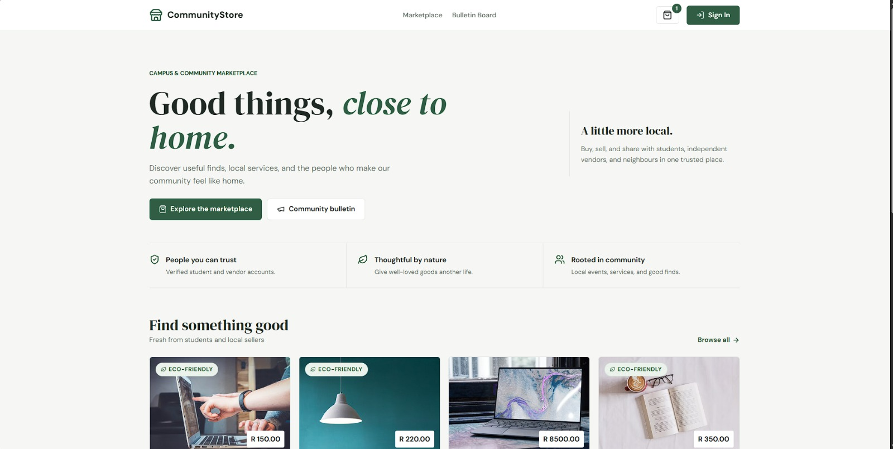
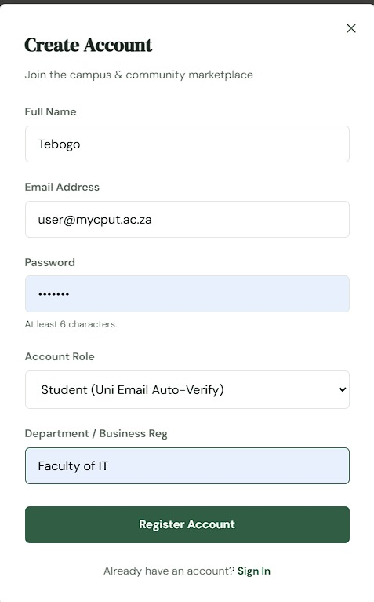
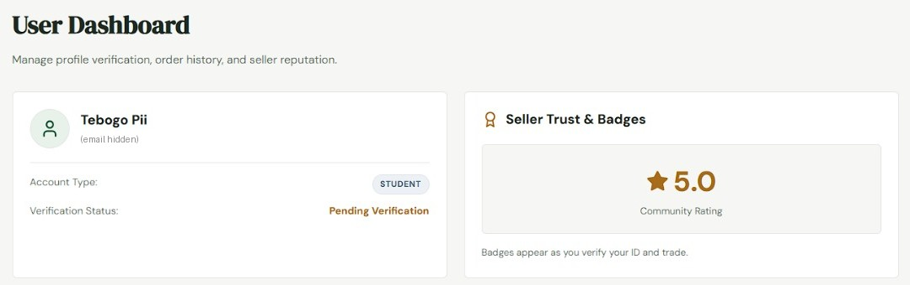
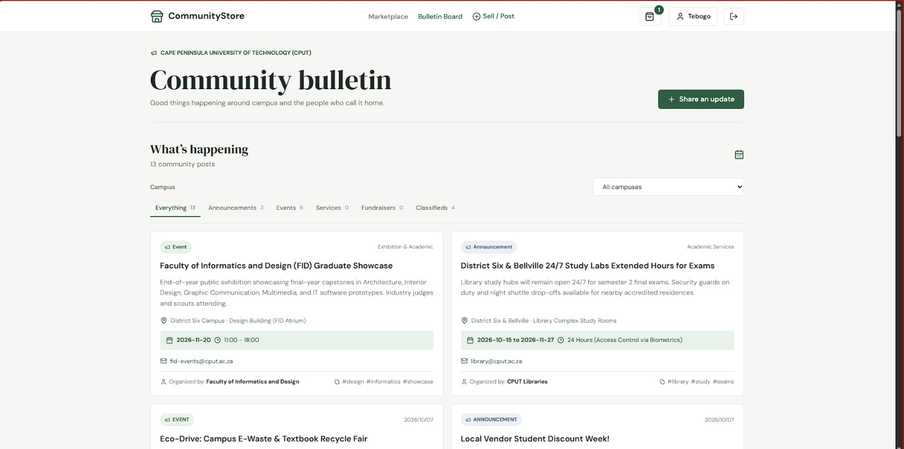
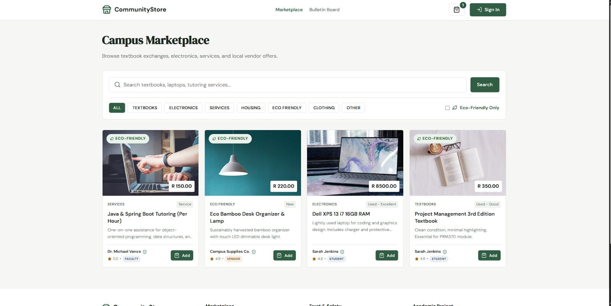
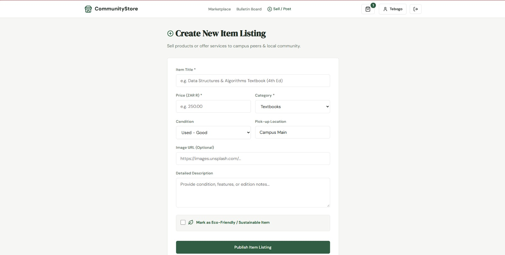
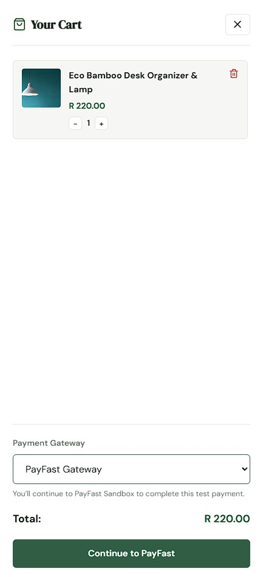
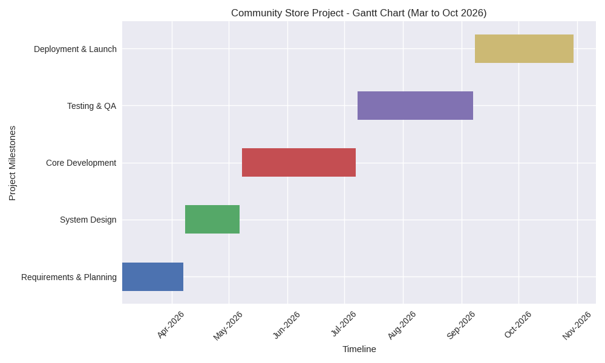
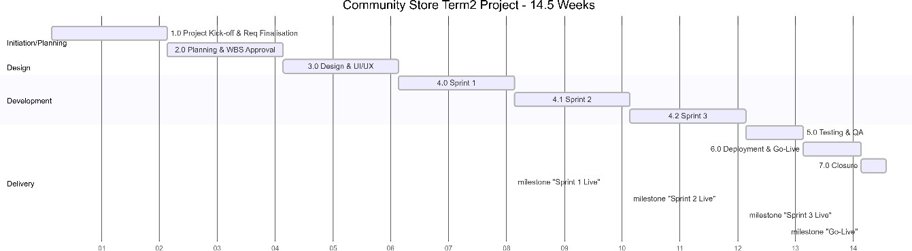

# Milani-Sani-Portfolio
📱 064 078 2189 | ✉️ 230371574@mycput.ac.za | 📍 143 Sir Lowry Rd, Foreshore, Cape Town, 8001
🔗 [linkedin.com/in/milani-sani-a0750126b](https://www.linkedin.com/in/milani-sani-a0750126b) | 🐙 [github.com/Milani-art](https://github.com/Milani-art)

---

## Profile

Hungry yet humble third-year ICT student specializing in Applications Development, with a strong drive to learn and grow as a software developer. Passionate about building practical solutions through coding, UI/UX design, and database management. Excited to apply academic knowledge to real-world challenges, contribute to collaborative projects, and continue developing into a versatile and impactful professional.

---

## Education

**Douglas Mbopha SSC**
2018 – 2022 | High School

**Cape Peninsula University of Technology**
2023 – present
- Higher Certificate in ICT *(Completed 2023)*
- Diploma in ICT Applications Development *(In Progress)*

---
# Mock Interview

Here is my Mock Interview:

<video width="1000" controls>
  <source src="Interview.mp4" type="video/mp4">
</video>

Recording a mock interview video has provided an eye-opening rehearsal space where I can observe my tone, body language, pacing, and clarity of answers. By reviewing the video multiple times, I have learnt to structure responses effectively, manage my nerves, and project confidence whilst also identifying habits like mumbling a few words over and over again or lack of eye contact. This practice has helped me build communication skills and prepared me to enter real interviews with greater poise and self-assurance.

## Technical Skills

- Programming & Development
- UI/UX Design
- Database Management
- Software Engineering Principles
- Web Development
- Project Documentation
- Collaboration & Communication

---

## References

**Kruben Naidoo**
Lecturer
naidook@cput.ac.za

**Siphokazi Tswane**
Lecturer
TswaneS@cput.ac.za

---

## CV

Creating a CV for me has been a valuable exercise in self‑presentation, as it requires me to carefully evaluate my skills, education, and experiences, then tailor them to 
highlight what matters most to potential employers. Beyond the content itself, building the CV using Markdown language added another dimension to the process, teaching me 
how to structure information cleanly, format text for clarity, and apply a widely used tool in technical environments. This combination of content creation and technical 
formatting has helped me communicate my strengths more clearly, cut out unnecessary details, and build self‑awareness about my value and areas for growth—all of which make 
me more confident and intentional in my career journey.

---
## Github Pages

Using GitHub Pages has been both a technical and a professional learning experience, as it has allowed me to showcase projects, portfolios, or documentation in a polished, 
accessible format. Setting it up has taught me practical skills in version control, hosting, and web presentation, while also giving me a platform to demonstrate 
my work to employers and collaborators. This feature is especially helpful for building an online presence that adds credibility beyond a CV and strengthens my 
career readiness. I was unaware that the feature was even available and I use GitHub regularly, so that goes to show how much I still have to learn.

---

# Agile Project Portfolio: Community Store

**Community Store** (PRM370/371/372S, 2026) is a mobile-first marketplace and community hub that connects CPUT students, faculty, local vendors and residents. Users can buy and sell textbooks, electronics and services, vendors are verified before they trade, and a community bulletin board shares campus announcements and events. It was built by a five-person team using Scrum, with a **Java 17 / Spring Boot 3** back end, a **React 18 + Vite** front end, a **MySQL** database and **PayFast sandbox** payments.

**My role:** I started the project as the team's **QA Engineer**. In that role I helped write our Term 2 planning documents (including the Risk Register and Change Management Records) and drafted the Build Outline the team used to plan development. In development I moved into **back-end development**, co-owning the API with a teammate. My half was **identity and community**: authentication, user verification and the bulletin board.

This page follows the four e-portfolio steps: I **collected** artefacts from across the project, **selected** the ones that best show how we worked, **reflected** on each, and **connected** them in the final section.

**Contents:** [Team Charter](#1-agile-team-charter) · [User Stories & Tasks](#2-user-stories-and-tasks) · [Product Backlog](#3-product-backlog) · [Sprint Backlog](#4-sprint-backlog) · [Agile Logbook](#5-agile-logbook) · [Connecting It All](#connecting-it-all)

**The product we built:**

---

## 1. Agile Team Charter

### Evidence

Our charter was set at the project kick-off in Sprint 1 and recorded across our Term 2 Communication Plan, Change Management Process and the Build Outline. The key agreements are summarised below.

**Purpose:** Deliver a trusted, mobile-first marketplace for the CPUT community, with verified accounts, secure payments and a community bulletin board.

**Team and roles**

| Member | Term 2 (planning) role | Term 3 (delivery) role |
|---|---|---|
| Inga Plati | Community Liaison | Community Liaison: bulletin board, UAT, user guide, FAQ |
| Reotsepile Kopano Stock | Project Manager / Front-end Developer | Security Specialist: encryption, RBAC, PayFast sandbox, email OTP |
| **Milani Sani (me)** | **QA Engineer** | **Back-end Developer**: identity & community API, ERD, API documentation |
| Tebogo Pii | Back-end Developer | Project Manager & QA Engineer: CI, E2E testing, portfolio compilation |
| Muhammad Siddeeq Rabin | Security Specialist | Front-end Developer: React UI, design system |

**Working agreements**

| Area | Our agreement |
|---|---|
| **Framework** | Scrum with two-week sprints, each closed with a sprint review and a retrospective. |
| **Communication** | WhatsApp for day-to-day team contact, a Jira board for sprint goals, tasks and blockers, Figma for design, and email/MS Teams for formal reporting. |
| **Meetings** | Daily stand-up for the development team; sprint planning, review and retrospective every sprint; risks reviewed at the end of each sprint. |
| **Decisions** | Minor changes are approved by the Project Manager. Changes with significant scope, schedule or cost impact go to the whole group. Every decision is logged with an approver and a date. |
| **Ownership** | One named owner per module and per deliverable, so nothing falls between two people. |
| **Definition of Done** | A story is done only when it meets every acceptance criterion, has unit and integration tests, is peer-reviewed in a pull request, passes CI, contains no secrets, and is demonstrated at the sprint review. |
| **Code conventions** | `main` is protected; one story per feature branch (`feature/US-00X-...`); conventional commit messages that include the story ID. |
| **Integrity** | All members sign a plagiarism declaration for every submission. |

### Reflection

Before this project I thought of a team charter as a formality. Ours turned out to be the thing that held the project together when it changed. Between Term 2 and Term 3 **almost every role on the team moved**: I went from QA Engineer to back-end developer, and our Project Manager role passed from one member to another. Because responsibilities were attached to *roles* and *modules* rather than just names, those handovers did not lose work. Each person knew exactly what they had picked up.

The agreement that changed my habits most was the **Definition of Done**. As QA Engineer I helped push for it, because "done" otherwise means "it works on my laptop". When I became a developer I had to live by it myself: every endpoint I wrote needed tests and a reviewed pull request before it counted. That felt slower at first, but it meant my code was rarely the reason a merge broke.

Our Sprint 1 retrospective also showed the charter's limits. Early meetings ran long because we disagreed about priorities and scope. The charter told us *who* decides, but not *how long* we debate, so we added "improve meeting time management" as an action item. If I wrote a charter again, I would include a timebox for discussions and agree to review the charter itself at every retrospective, because a team's rules should change as the team does.

---

## 2. User Stories and Tasks

### Evidence

All user stories were written in the *As a… I want… so that…* format, with acceptance criteria for traceability and testing. Below are the stories from my part of the back end, with the tasks they broke into and where they live in our Spring Boot code.

🎨 [UI designs these stories were built against (Figma)](https://www.figma.com/design/iNOjYLcZWKvoE3gprkUknK/UniTrade?node-id=0-1)

**US-001: User Registration & Login** *(Must, 8 points)*
> As a student, I want to register using my university email, so that I can access the platform with a verified identity.

| Acceptance criteria | Tasks |
|---|---|
| • User can register with a valid university email address • Duplicate email addresses are rejected with a clear error message • Successful login redirects to a role-appropriate dashboard • Repeated failed logins lock the account | • `User` and `Role` models (Student, Faculty, Vendor, Resident, Admin) • `POST /auth/register` and `POST /auth/login` • Password hashing and JWT issuing (`JwtUtils`, `JwtAuthFilter`) • Clear JSON errors via a global exception handler • Service and API tests |

**US-006: Vendor / User Verification Workflow** *(Must, 5 points)*
> As a platform administrator, I want to review registration details, so that I can keep marketplace integrity by approving or rejecting sellers.

| Acceptance criteria | Tasks |
|---|---|
| • New accounts default to a *Pending* state • Pending accounts appear in an admin queue • An admin can approve or reject an account • Pending vendors cannot add listings until approved | • `VerificationStatus` state machine: `PENDING → APPROVED / REJECTED` • `POST /users/me/request-verification` • `GET /users/pending-verification` (admin queue) • `PUT /users/{id}/verify` and `PUT /users/{id}/reject` • Role-based guards on admin endpoints |

**US-009: Community Bulletin Board** *(Should, 5 points)*
> As a user, I want to post and view announcements or events, so that I can engage with the broader community.

| Acceptance criteria | Tasks |
|---|---|
| • Verified users can create posts in set categories • Posts show author, date and category badge • Admins can remove inappropriate posts | • `BulletinPost` model and `PostType` (Announcement, Event, Service Offer, Fundraiser) • `GET /bulletin`, `GET /bulletin/{id}`, `GET /bulletin/mine` • `POST`, `PUT` and `DELETE /bulletin/{id}` with ownership checks • Category validation in `BulletinService` |

**Test coverage of these stories:** 42 automated tests across `AuthServiceTest`, `UserServiceTest`, `BulletinServiceTest` and `IdentityAndBulletinApiTest`, running against an in-memory H2 database.

### Reflection

Writing requirements as user stories made me ask *who* a feature is for before *how* to build it. The verification story is the clearest example. It showed me that a vendor is not a separate kind of account but a user who has earned trust. That is why I modelled verification as a **status on the user** (`PENDING`, `APPROVED`, `REJECTED`) instead of building separate account types, and why a rejected user can fix their details and re-apply rather than being locked out for good.

My QA background changed how I read acceptance criteria. I treat each criterion as a test waiting to be written, so I read the criteria *before* writing an endpoint and build to them. That is why the identity and bulletin modules have tests for failure paths (duplicate emails, unauthorised edits, invalid categories), not just the happy path.

The hardest part was breaking stories into tasks. In our Sprint 2 retrospective we admitted that some requirements were open to interpretation, which made story points hard to estimate. I saw the same thing in my own work: "verification" sounded like one task but was really a model change, four endpoints, role guards and tests. Next time I would split stories into tasks during sprint planning, with the team, so hidden work shows up before we commit to it.

---

## 3. Product Backlog

### Evidence

The backlog captures all functional and non-functional requirements. Items were prioritised with **MoSCoW** (High = Must, Medium = Should, Low = Could) and estimated with **Fibonacci story points**.

| ID | Feature | Priority | Points | Delivery decision |
|---|---|---|---|---|
| US-001 | User registration & login | High | 8 | Built in full |
| US-002 | Product listing | High | 5 | Built in full |
| US-003 | Search & filter | High | 5 | Built in full |
| US-004 | Cart & checkout | High | 8 | Built in full |
| US-005 | Payment integration (PayFast / SnapScan) | High | 8 | Built: PayFast sandbox only |
| US-006 | Vendor onboarding & verification | High | 5 | Built in full |
| US-007 | Notifications | Medium | 3 | Simplified: in-app + email, no mobile push |
| US-008 | Ratings & reviews | Medium | 3 | Simplified: completed orders only |
| US-009 | Community bulletin board | Medium | 5 | Built in full |
| US-010 | Admin dashboard | Medium | 8 | Simplified: management + basic counts |
| US-011 | Fraud detection | Low | 13 | Deferred: design specification only |
| US-012 | Performance (5 000 users, <2 s) | Low | 13 | Deferred: load-test report and scaling plan |
| US-013 | Accessibility (WCAG 2.1 AA) | Low | 5 | Simplified: audited, not certified |
| US-014 | Encryption, hashing & HTTPS | Low | 5 | Built in full |

The marketplace as delivered:

### Reflection

The product backlog gave five people one shared picture of everything the marketplace could be. It also showed us honestly that we could not build all of it: 14 items and over 90 story points was more than our time allowed.

The most important thing I learned is that **a backlog is only useful if you are willing to cut it**. When I drafted the Build Outline, I split the backlog into three groups: *build in full*, *build simplified* and *document, don't build*. Fraud detection (13 points) needed transaction volumes we would never have, so it became a design specification. Payments were narrowed to the PayFast sandbox, with SnapScan (approved in CR-001) kept as a documented extension point. Those decisions protected our time for the Must-haves, which is why the core buyer journey in the screenshots above actually works.

I also learned that priorities are negotiated, not assigned. Two of my stories (US-001 and US-006) blocked almost everything else, because nobody can list, buy or post without an account and a verification status. Once I saw that, I treated my own items as the critical path and flagged them early. In future I would add dependency notes to the backlog itself, so the order of work is visible to everyone, not just the person who spots it.

---

## 4. Sprint Backlog

### Evidence

The project ran on **two tracks**. Planning sprints 1–4 (Term 2) produced our documents and designs. Development sprints D1–D5 then built the system, followed by a final delivery sprint in Term 3.

**Planning sprints (Term 2)**

| Sprint | Sprint goal | Sprint backlog / deliverables |
|---|---|---|
| 1 | Understand the brief, identify stakeholders, assign roles and set up how we work | Scope agreed, roles assigned, Communication Plan, initial Risk Register, WhatsApp and Figma set up |
| 2 | Prepare for design by organising the backlog and defining user stories | WBS, Gantt chart, activity sequencing, prioritised Product Backlog, user stories, sprint plan |
| 3 | Define layout, navigation and user experience with low-fidelity wireframes | Low-fidelity wireframes, user flow diagrams, navigation structure, design review feedback |
| 4 | Turn approved wireframes into a polished, interactive prototype | High-fidelity mockups, design system, reusable components, interactive Figma prototype |

**Development sprints (from the Build Outline)**

| Sprint | Stories | Sprint goal (exit criterion) |
|---|---|---|
| D1: Foundations & Authentication | US-001, US-006 | A user can register, log in and land on a role-appropriate dashboard |
| D2: Catalogue & Discovery | US-002, US-003 | A verified vendor can publish a listing, and a buyer can find it by search and filter |
| D3: Cart, Checkout & Payment | US-004, US-005, CR-004 | A buyer completes a sandbox purchase end to end |
| D4: Community, Reviews & Admin | US-009, US-008, US-007, US-010 | All in-scope features work and a UAT session runs with real students |
| D5: Hardening, Testing & Handover | US-013, US-014, US-011/012 docs | Production-ready build, all tests green, documentation complete |

**Final delivery sprint (Term 3)**

*Sprint goal: a complete, working application, one compiled portfolio and a 10-minute video meeting every Term 3 criterion.*

| Day | Milestone | Backlog items |
|---|---|---|
| Mon / Tue | Code freeze & QA | Merge all feature branches to `main`; run the full E2E suite; fix critical and high-severity defects |
| Wednesday | Portfolio compilation | Each member submits their documentation; the PM compiles one portfolio |
| Thursday | Video recording | 10-minute MP4, with a two-minute segment per member |
| Friday | Final review | Verify the portfolio, zipped artefact, video and signed plagiarism declaration |

**My items in the final sprint:** database schema (ERD) · API documentation · clean, commented back-end code for the artefact · two-minute back-end architecture segment for the video.

### Reflection

Seeing our sprint backlogs side by side taught me that **a sprint plan is a forecast, not a promise**. The Build Outline assumed a Node/Express back end and had me on a QA-only lane. By the time we built, the team had moved to **Spring Boot 3** and I was co-owning the back end. A rigid plan would have broken at that point. Because we planned in two-week sprints with clear exit criteria, we could re-plan the next sprint around who was doing what, without throwing away the goals.

The exit criteria were the most useful part of each sprint backlog. "A user can register, log in and land on a role-appropriate dashboard" is something you can demonstrate or not, which made sprint reviews honest. It also shaped my work in D1: because my identity module was the gate for every other feature, I focused on getting registration, login and verification stable before adding extras.

The final sprint showed me the value of a **code freeze**. Once features stopped changing, testing could tell us what was actually broken instead of chasing a moving target. From my QA experience, I would go further next time and hold a small freeze-and-test step at the end of *every* sprint, not just the last one, so quality is built in along the way rather than rushed at the end.

---

## 5. Agile Logbook

### Evidence

Our logbook combines sprint retrospectives with the dated Change Request Log, so every decision has an owner, a date and a reason.

| Date | Entry type | Key points | Actions / outcome |
|---|---|---|---|
| Sprint 1 (Requirements & Planning, Mar 2026) | Kick-off & retrospective | **Went well:** shared understanding of objectives; roles assigned to strengths; early communication channels. **To improve:** meetings ran long over differing priorities; tools took time to learn. | Finalise documentation before the next sprint; improve meeting time management; keep refining requirements. |
| Sprint 2 (Requirements & Planning) | Retrospective | **Went well:** project broken into manageable tasks; backlog prioritised. **To improve:** some requirements were open to interpretation, so story points were hard to estimate. | Keep refining user stories; revisit estimates; review backlog priorities at the start of every sprint. |
| 20 Apr 2026 | Change request CR-001 | T. Pii requested SnapScan as a second payment gateway. | Approved by the PM on 25 Apr (+3 days). |
| Sprint 3 (System Design, Apr–May 2026) | Retrospective | **Went well:** wireframes exposed navigation problems before detailed design. **To improve:** several screens needed multiple revisions; earlier user feedback was needed. | Validate wireframes with users; standardise layouts; finalise navigation before high-fidelity design. |
| 05 May 2026 | Change request CR-002 | I. Plati requested a "Service" category for bulletin board posts, at vendors' request. | Approved on 06 May; no schedule impact. |
| **12 May 2026** | **Change request CR-003 (raised by me)** | **As QA Engineer, I requested a 3-day extension to Sprint 4 for an extra penetration testing cycle, after the first test revealed vulnerabilities.** | **Approved on 13 May; absorbed within existing float.** |
| 20 May 2026 | Change request CR-004 | M.S. Rabin requested two-factor authentication for purchase confirmations, after the data-breach risk assessment. | Approved on 22 May; +5 story points added to the backlog. |
| Sprint 4 (System Design) | Retrospective | **Went well:** consistent mobile-first designs; reusable components. **To improve:** more usability testing needed; late design changes caused rework. | Run structured usability testing before development; document the design system; organise assets for handover. |
| 02 Jun 2026 | Change request CR-005 | R.K. Stock proposed moving from Adobe XD to Figma for real-time collaboration. | Approved by the whole team on 03 Jun. |
| 30 Jun 2026 | Milestone | Term 2 submission: backlog, user stories, risk plan, change log, sprint plans and retrospectives. | Signed off by all five members. |
| Jul–Aug 2026 | Development planning | Build Outline drafted: scope split, D1–D5 sprint plan, Definition of Done, branching rules. | Adopted as the team's development plan. |
| Oct 2026 | Final sprint planning | Term 3 game plan: deliverables mapped to updated roles; five equal video segments; freeze → compile → record → review. | Each member submits their documentation by Wednesday; PM compiles the portfolio. |

### Reflection

The logbook turned out to be the team's memory. Months later, when someone asked why we only integrated PayFast, or why the bulletin board has a *Service* category, the change log answered in one line, with a name and a date. I wrote our Change Management Records in Term 2, and that taught me the habit I value most from this project: **record the decision at the moment it is made, with the reason.**

The entry I am proudest of is **CR-003**. As QA Engineer, the first penetration test showed vulnerabilities, and the easy option was to sign off anyway and hope. Instead I raised a formal change request to extend the sprint by three days. Because our change process existed, it was a five-minute, evidence-based decision instead of an argument. The extension fit within our float, so the schedule still held. It taught me that raising a quality concern early is part of the job, not an inconvenience to the team.

Reading the retrospectives in order also shows the team learning. Sprint 1 asked for shorter meetings, Sprint 2 for better-refined stories, Sprint 3 for earlier user feedback, and Sprint 4 for structured usability testing. Each retro built on the last. The gap in our logbook is daily stand-ups: they were planned in our Communication Plan, but we kept no written record of them. Next time I would keep a short stand-up log (done / doing / blocked) so that blockers are tracked as carefully as our formal changes.

---

## Connecting It All

Looking at these artefacts together, I can see how each one fed the next. The **team charter** set our roles, working agreements and Definition of Done. That is what let us survive almost every role changing between terms without losing work. Those roles shaped the **user stories and tasks** we wrote, which filled a **product backlog** we then had the discipline to cut down to what mattered. Each **sprint backlog** pulled the next most valuable work into a two-week goal we could demonstrate, and the **logbook** captured what we learned in retrospectives and why every change was made.

Being QA Engineer and then a back-end developer on the same project let me see this cycle from both sides. As a tester, I learned that quality depends on clear acceptance criteria and the courage to raise problems early, as I did with CR-003. As a developer, I learned that those same criteria are the best specification I can build from, which is why my identity and bulletin modules are backed by 42 automated tests.

The biggest shift in my thinking is that Agile is not a set of documents but a feedback loop: **plan, build, test, reflect and adjust**. The documents matter because they make that loop visible. These are the habits I am taking into my Work-Integrated Learning and my career as a software developer.
